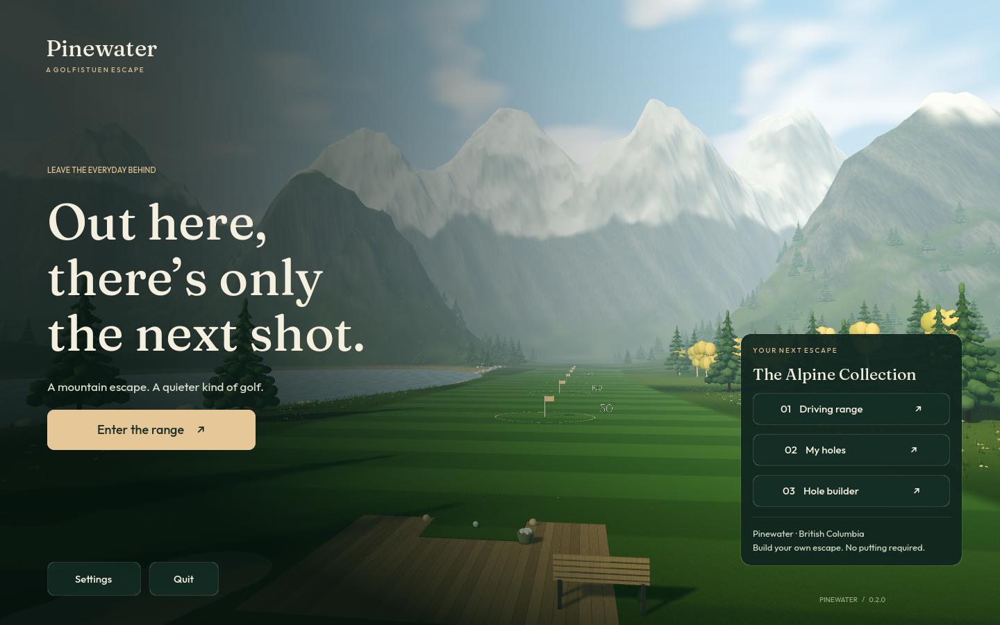
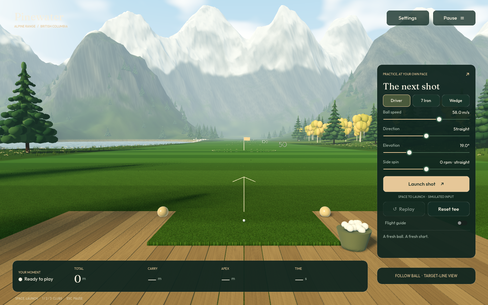
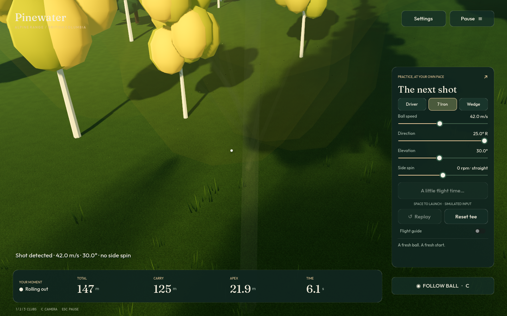
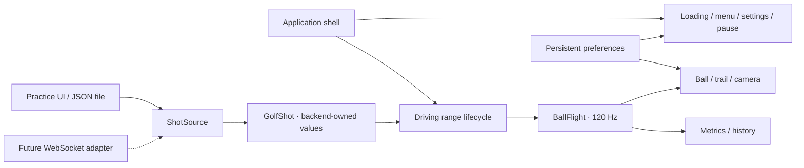

# Pinewater

**An alpine golf escape by Golfistuen.** A native desktop game with a staged loading
screen, scenic main menu, saved settings, a driving range, and an integrated hole
builder with playable custom holes, and **1–6 player local competitive golf**. Radar is
optional: built-in practice controls generate the same launch events as a future
backend connection.

## Play the native application

After a release build, open the relevant folder and double-click the application:

| Platform | Player application |
| --- | --- |
| Linux x86-64 | `dist/pinewater/0.2.0/Pinewater-linux/Pinewater` |
| Windows x86-64 | `dist/pinewater/0.2.0/Pinewater-windows/Pinewater.exe` |
| macOS universal | Configured export preset; build and validate on macOS before distribution |

Portable ZIP downloads, player instructions, licenses, a JSON manifest, and SHA256
checksums are generated next to the application folders. Players do **not** need
Python, an installed Godot editor, an internet connection, or the radar backend.

The current Linux and Windows packages are built locally. Linux has runtime and
graphical verification here; the Windows CI job runs the native Windows smoke
test. Windows/macOS distribution signing uses publisher credentials and is not
enabled in this checkout.

See [`PLAYER_GUIDE.txt`](PLAYER_GUIDE.txt) for player-facing instructions.



## Experience

- **Loading:** real progress through resource loading and environment construction.
- **Main menu:** animated scenery, mode selection, Settings, and Quit.
- **Driving range:** standalone practice with simulated or external shot input.
- **Local golf:** six-player score strip, independent balls/lies, honours and
  farthest-away turn order, Maximum Score or ordinary gross stroke play, relief,
  pickup/DNF, full scorecards, shared winners and automatic disk resume.
- **Clubhouse:** reusable ordered courses, seeded 1–36-hole generation, colourful
  animated square-headed golfers and optional local photo portraits.
- **Course guide:** live overhead map with painted hazards/trees, aim line, shot
  trail, player balls, distance rings, pin/front/back yardages and click-to-measure
  lay-up points. Also includes the practice range's actual target layout.
- **Hole builder / My holes:** paint and sculpt an empty rough plot, place a cup,
  tee and trees, save/export designs and play them with no-putting scoring.
- **Settings:** fullscreen, three graphics presets, metres/yards, reduced camera
  motion, trail visibility, and three volume controls. Gameplay always follows the ball.
- **Pause:** preserves an active shot and resumes it without advancing physics.
- **Practice:** club presets, adjustable launch parameters, trajectory guide,
  flight, bounce, rollout, metrics, recent shots, replay, and reset.

Preferences persist under Godot's per-user `Pinewater` application-data folder.
The settings loader validates types/ranges and falls back to defaults for invalid
or unreadable values. Practice history remains in memory for the session.

### Build and play your own holes

Choose **Hole builder** in the main menu. Paint fairway/green/rough/water/sand/OOB,
sculpt hills or valleys, place trees and a cup, then **Save** or **Test this hole**.
**My holes** contains your saved designs and a playable sample.

No putting is required: a ball at rest on a green finishes with **+2 automatic
strokes by default**, configurable under **Settings → Simulator rules**. Scoring
and rules are separate from the terrain model, with gross-result history retained
for future scoring policies. See [Hole Studio documentation](docs/HOLE_STUDIO.md)
for controls, file format, penalties, architecture and limitations.

### Play a local competition

Choose **Play local golf**, add **1–6 players**, select colours/photos, and choose
the first-tee order (agreed list order or drawn honours). Build a course from
playable library favourites, or generate 1–36 holes with a reproducible seed and
chosen cup size. Saved courses retain ordered **complete hole snapshots**.

Default **Maximum Score** supports pickups at an announced cap. Ordinary stroke
play has no cap and pickup records **DNF/unclassified**. After the initial tee
strokes, farthest from the cup plays next. Subsequent honours use previous-hole
gross scores, with stable ties. The top strip shows all scores; the scorecard
handles hole transitions and shared wins.

**Relief / drop** offers stroke-and-distance, lateral, back-on-line and bunker
options, plus a separately labelled **fairway rescue +2 house rule**. Automatic
green strokes, fairway rescue and simplified water handling are declared simulator
policies; this is not a complete tournament-rules implementation.

The active round is checkpointed before launch and after every scoring action.
**Resume saved round** restores all players, layouts, lies and scores. Interrupted
shots re-simulate from launch without being counted twice. Photos are cropped to
256 × 256 local PNG files and never uploaded. See [Local golf](docs/LOCAL_GOLF.md)
for the precise rules, storage and verification scope.

### Art and rendering

Original, seeded procedural scenery: a continuous sculpted heightfield, blended
grass/rock/snow material, mown fairway, wooded foothills, needle-cushion spruce
boughs, autumn aspens, shoreline rocks, wind-blown grass and wildflowers, timber
decking, a bench and basket of balls. Sky, clouds, water, flags, and foliage are
shader-animated. Forward+ adds soft shadows and filmic tonemapping. The playing
view has no lens overlay, bloom, noisy screen-space occlusion or screen-reading
water distortion. Outfit and Fraunces provide a consistent UI type system.

Close views use a locally bundled 2K ambientCG grass material, anisotropic mipmaps,
and three world-anchored detail patches of individual short blades. The patches
sample the rendered heightfield on the GPU, so moving the follow camera does not
trigger large per-frame CPU grass rebuilds. Nearby decking has directional wood
grain, and the ball has staggered dimples, a subtle marking, and visible rolling
rotation.

The single shot camera starts directly behind the tee/aiming line and follows the
interpolated ball into a closer rollout view. A centred arrow makes the forward
target line visible before launch. Objects do not orbit, lift or snap the camera. Complete
obstructing trees and props smoothly become transparent, then restore their normal
opacity when the view clears. Their shadows use independent geometry and remain
stable. This uses continuous alpha, not noisy pixel cutouts. Only actual terrain
sets a minimum camera height. There are no tee/overview camera switches or optional
follow mode during play; the builder's plan/3D authoring views remain independent.

The trail is a short, camera-facing, softly feathered ribbon, using a bounded
physics-sample ring and Hermite interpolation. It is rebuilt within a fixed small
vertex budget once per rendered frame, after the camera has updated, with its head
attached to the interpolated ball. It tapers over 0.85 seconds of flight history and
fades out over 0.35 seconds after landing.

Tree meshes are shared, indexed and batched with MultiMesh. Quality presets reduce
render resolution, vegetation density, shadow distance and antialiasing cost.
The compatibility renderer is available through the included Linux OpenGL launcher
or `--rendering-method gl_compatibility`.





[View the soft trail and right-side-spin flight](docs/flight.png).

### Controls

| Key | Action |
| --- | --- |
| Space | Launch a simulated shot |
| 1 / 2 / 3 | Driver / iron / wedge |
| R | Range: fresh ball; solo test: restart; competition: confirm pickup |
| P | Replay without adding a history entry |
| Escape | Pause / resume / back |
| F11 | Fullscreen |

Buttons and sliders support keyboard focus. Fullscreen can also be controlled in
Settings. The menu preserves the practice session when returning to the range.

## Develop

Godot **4.5.1** is pinned for release builds. Python **3.10+** is developer tooling
only. From the repository root:

```bash
python3 tools/run_range.py                 # Main menu
python3 tools/run_range.py --range         # Directly enter practice
python3 tools/run_range.py --editor        # Godot editor
python3 tools/run_range.py --check         # Headless checks
```

The launcher finds `--godot PATH`, `GODOT_BIN`, or Godot on PATH; otherwise it
downloads the pinned official engine with SHA512 verification. The engine is
cached outside the repository. No pip packages are required.

### Build native releases

```bash
python3 tools/build_range.py --target linux windows
```

The builder checks the pinned engine version, imports assets, runs contract,
physics and application tests, installs checksum-verified export templates, then
exports native release binaries with embedded game data. It smoke-tests the
executable on its host platform and creates portable packages and checksums.
The official multi-platform template download is about 1.3 GB, cached once.

`golf_game/export_presets.cfg` also includes a macOS universal preset:

```bash
python3 tools/build_range.py --target macos
```

`.github/workflows/pinewater-release.yml` performs checked native Linux and Windows
builds on their respective runners and uploads the packages. It runs on relevant
pull requests, manual dispatch, and `pinewater-v*` tags. It does not publish a
storefront release. Configure code signing/notarization with release credentials
when preparing public distribution.

### Structure

```text
golf_game/
├── project.godot / export_presets.cfg
├── scenes/
│   ├── application.tscn             Player entry point
│   └── driving_range.tscn           Independently runnable game mode
├── scripts/
│   ├── app/
│   │   ├── application.gd           Loading, navigation, pause, transitions
│   │   ├── game_settings.gd         Validated persistent user preferences
│   │   └── audio_director.gd        Original ambience and sound cues
│   ├── driving_range.gd             Shot/session lifecycle and composition
│   ├── domain/                     Backend launch data, pure flight solver
│   ├── holes/                      Editor, versioned hole data, play and scoring
│   ├── match/                      Competitive domain, courses, roster, resume, characters and UI
│   ├── input/                      Common shot source and standalone simulator
│   ├── world/
│   │   ├── alpine_range.gd          Staged environment composition
│   │   ├── landscape.gd             Heightfield generation and sampling
│   │   ├── nature_meshes.gd         Shared vegetation/rock geometry
│   │   ├── range_surface.gd         Shared visible surface/contact heights
│   │   ├── close_turf.gd            Camera-local, GPU-projected short grass
│   │   └── camera_clearance.gd      Indexed hard-occluder/foliage proxies
│   ├── presentation/               Cameras, ball, shadow, trail, palette
│   └── ui/                         Shared style, loading, menus, settings, HUD
├── shaders/                        Terrain, foliage, grass, water, sky, flags, UI
├── tests/                          Domain, integration, app flow, visual capture
├── assets/ / licenses/              Local original artwork and font/engine notices
└── PLAYER_GUIDE.txt                 Shipped player documentation
```

The application shell owns navigation and preferences. A game mode owns shot
lifecycle. The world owns scenery. The UI emits intent and displays state. None of
these components parses serial packets or imports radar-backend code.

## Shot contract and backend integration

```json
{
  "shot_id": "example-001",
  "speed_mps": 42.0,
  "direction_deg": 3.0,
  "elevation_deg": 30.0,
  "spin_rpm": 1200.0
}
```

Direction is relative to the calibrated target line; positive is right. Elevation
is degrees above horizontal. Godot uses +X right, +Y up, and −Z down the range.
Backend launch values are trusted and used as supplied: there are no frontend
speed, angle or spin limits. A shot ID is optional (generated locally when absent),
and omitted launch fields default to zero. Numeric IDs and the simple field aliases
`speed`/`velocity`, `direction`, `elevation`, and `spin` are also accepted. Extra
metadata is ignored. Shot validation and unit correctness belong to the backend.
JSON shot files must decode to an object. Display unit preferences do not change
simulation units; the practice sliders' convenient ranges do not constrain input.

`spin_rpm` is **side spin only**, about the vertical axis: negative curves left,
positive curves right, zero is neutral. It is independent of launch direction and
does not supply backspin or topspin. Practice controls expose ±4,000 RPM; backend
values have no such bound. Older payloads without this field default to zero.

```bash
python3 tools/run_range.py --shot golf_game/examples/shot.json
```



A future WebSocket adapter extends `ShotSource` and calls `submit_payload(payload)`;
connect its `shot_received` signal just like the demo source. The range also exposes
`receive_shot(payload)`. Parsing success is distinct from game acceptance. The
range runs one ball at a time and custom holes only launch while a turn is ready;
these lifecycle rules do not filter launch values or require unique metadata IDs.
Transport readiness, turn IDs, acknowledgements and reconnect/resume belong in
the future integration layer.

### Simulation scope

The center of the practice range is flat. The ball samples the actual rendered
ground triangles, including the tee, target greens, and sloping rough, rather than
rolling on a fixed-height plane. Flight uses gravity,
quadratic drag, explicit assumed lift, damped bounces and surface-dependent rolling
resistance. Signed side spin supplies a horizontal Magnus force, decays in flight,
and is damped on impact and during rollout. It does not supply vertical spin lift
or an artificial sideways steering force while rolling. Aerodynamic coefficients
and the baseline lift term are gameplay-tuned; the app is not a calibrated launch
monitor.
The physical radius is 21.35 mm. A small, smoothly changing render-size boost keeps
the ball legible at a distance; its center is lifted by the same amount so its
bottom still meets the turf. The preview and the actual shot share one solver and
surface sampler. On the driving range, water-hazard rules and scenery impacts are
not scored. Custom holes add water/OOB penalties and trunk deflections through the
shared custom-hole simulator; see the Hole Studio guide.
Cameras, distance-unit preferences and graphics settings cannot alter shot physics.

## Verification and visual review

`run_range.py --check` covers unrestricted backend input (including a 4000 m/s
regression), optional IDs/field aliases, launch axes, all presets,
landing/rollout, busy events, preview agreement, replay, reset,
startup/menu flow, UI launch, pause/resume, settings navigation, unit conversion,
and actual preference save/reload. Checks have watchdogs and nonzero failure exits.
Camera checks follow entire short, long, and wide shots at 30/60/120 Hz, verify
framing clear of the HUD, and prove that adding obstacles cannot change the camera
path. Other checks cover behind-the-tee alignment, mirrored side-spin curvature, smooth
object-opacity transitions, material isolation, bounded trail geometry, exact trail
head attachment, landing fade-out, and visible-surface contact.

Match checks cover honours/ties, farthest-away order, OOB tee priority, caps,
pickup/DNF, relief/bunker constraints, generated courses, portraits and disk
persistence. Application integration exercises six-player setup, generated/saved
courses, contact-timed swings, in-flight restart without duplicate scoring,
pause/scorecard isolation, replay, relief confirmation, pickup, hole transitions
and tied results. Native packages run `--smoke-match` as well as the range and
hole-builder smoke tests.

Render ordering is deliberate: ball interpolation at priority 0, camera at 10,
camera-facing trail at 12, obstruction opacity at 15, and close turf at 20. New
presentation features should preserve this ordering rather than introduce another
lagging copy of the ball or camera state.

The release executable has a resource/navigation smoke test:

```bash
dist/pinewater/0.2.0/Pinewater-linux/Pinewater --headless -- --smoke-app
```

For native screenshots see [`docs/README.md`](docs/README.md). Developer visual
helpers can capture settings, flight, shot results and history:

```bash
godot --path golf_game --script res://tests/capture_application.gd -- /tmp/menu.png
godot --path golf_game --script res://tests/capture_application.gd -- /tmp/settings.png --settings
godot --path golf_game --script res://tests/capture.gd -- /tmp/flight.png --flight
godot --path golf_game --script res://tests/capture_follow.gd -- /tmp/rolling.png --rolling
godot --path golf_game --script res://tests/capture_follow.gd -- /tmp/forest.png --wide --rolling
godot --path golf_game --script res://tests/capture_follow.gd -- /tmp/spin.png --flight --spin-right
```

Visual helpers require a graphical desktop. Import once with the launcher before
direct engine commands on a fresh checkout. `tests/` and `docs/` are excluded from
player exports.

## Notices

Outfit: `assets/OFL.txt`. Fraunces: `assets/Fraunces-OFL.txt`. Godot and its bundled
libraries: `licenses/`. These notices are copied into each portable player package.
Grass 004 colour/normal maps are CC0 assets by ambientCG; see
`assets/turf/SOURCE.md` and `licenses/ambientCG-Grass004.txt`.
