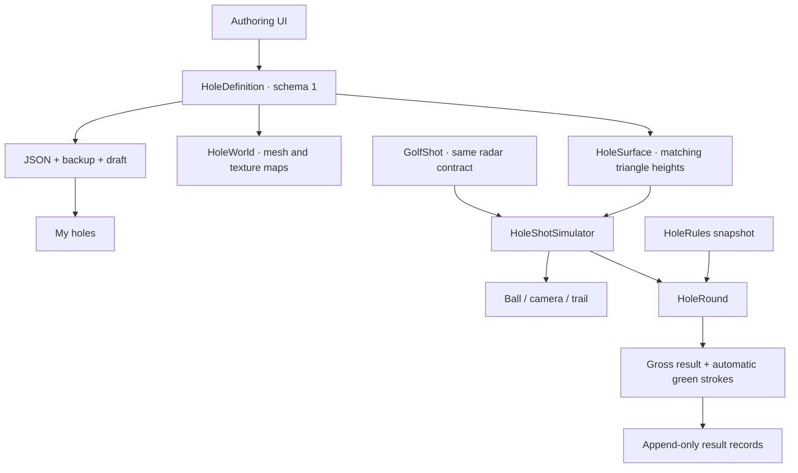
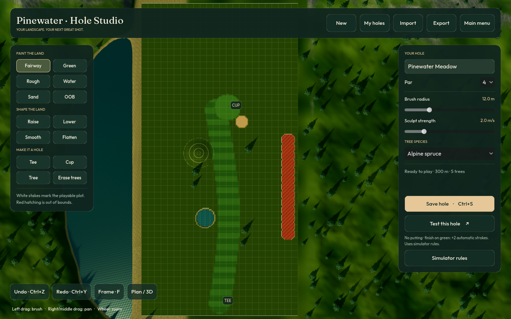
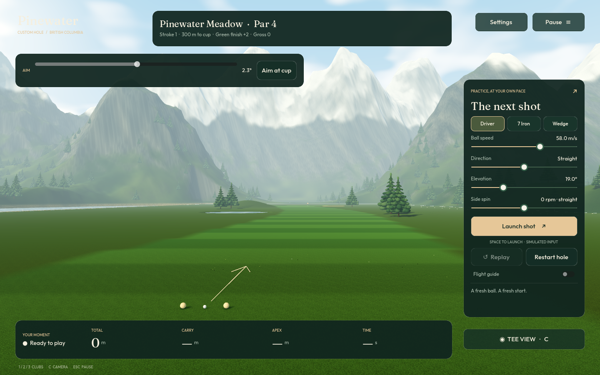

# Hole Studio and custom-hole play

The main menu includes **Hole builder** and **My holes**. Both are part of the
native application; no backend, editor installation, or Python is needed to use
them. The surrounding alpine landscape, lighting, and art assets are shared with
the driving range.

## Build your first hole

1. Open **Hole builder**. A first/new design is an empty **240 × 480 metre rough
   plot**, with a movable tee and no prebuilt fairway or green.
2. Paint **Fairway**, **Green**, **Rough**, **Water**, **Sand**, and **OOB** with the
   left mouse button. Brush radius is adjustable. Water painting also carves a
   pond below the water surface.
3. Use **Raise**, **Lower**, **Smooth**, or **Flatten** to make hills and valleys.
   Sculpt strength controls metres per second; flatten samples the initial click's
   elevation. Plan view shows a 10 m grid and hill contours. **Plan / 3D** switches
   to an angled preview.
   For a recessed bunker, paint Sand and use Lower/Smooth to shape its depth and rim.
4. Select **Tee** or **Cup**, then click to place it. The cup must be on a painted
   green, and at least 10 m from the tee, before the hole can be played.
5. Place **Trees** (spruce or aspen), or remove them with **Erase trees**. Tree
   placement uses 2.5 m spacing and supports up to 256 trees per design.
6. Set a name and par, then **Save hole**. It appears in **My holes**. **Test this
   hole** switches directly into gameplay; **Edit this hole** returns to authoring.

**Right/middle drag** pans, **wheel** zooms, **F** frames the full plot,
**Ctrl+Z / Ctrl+Y** undo/redo, and **Ctrl+S** saves. Each complete brush drag is one
undo action. Thirty undo snapshots are retained. Editor distances are metres even
when gameplay distance display uses yards.

Surface painting, sculpting, undo/redo and terrain picking all operate on the same
document. Rendering updates are throttled while sculpting and refresh only the
dirty vertex/normal region; the stroke's final frame is synchronised immediately.

## Save, import and export

- Designs are versioned JSON under `user://holes/` in Pinewater's per-user app-data
  folder. They do not require write permission in the installation directory.
- **Import** accepts an exported `.json` document, validates it, and gives it a new
  ID to avoid overwriting another design. **Export** writes a shareable JSON file.
- Saves use a temporary file and previous-version backup. Missing final files can
  be recovered from backups on startup.
- Leaving the builder keeps a separate draft. New/replacing designs are distinct
  from saved library entries; use **Save** to publish an edit to your local library.
- Invalid/incomplete designs can be saved and edited; **Play** stays disabled until
  the tee/green/cup checks pass.

**My holes** includes a ready-to-play **Pinewater Meadow** sample. **Edit a copy**
starts a user-owned copy. Saved designs have their own **Edit** and **Play** actions.

## Play without putting

Custom holes use the same speed, direction, elevation and signed side-spin input
as the range. The game aims toward the cup from each new lie. Adjust the **Aim**
slider, or choose **Aim at cup**, before taking a shot. Radar direction remains a
deviation from that virtual aiming line; no extra radar payload fields are needed.

Each next shot starts at the previous ball's resting lie. The edited triangle
surface drives flight contact, hills, valleys and rolling. Fairway, rough, green,
and sand have different rolling resistance; sand also softens impact. Placed tree
trunks can deflect shots. The camera retains the smooth follow/transparency system.

There is **no putting phase**. Once a ball comes to rest on a green:

- The attempt completes with the configured **additional automatic strokes**.
- The default is **+2**. One real shot onto the green scores 3; two real shots onto
  the green score 4, before any penalties.
- A directly holed shot adds **zero** automatic strokes.
- Merely flying across a green does not complete the hole.

Open **Settings → Simulator rules**, or **Simulator rules** in the builder, to set:

| Rule | Default | Range |
| --- | --- | --- |
| Automatic strokes on green | 2 | 0–3 |
| Water penalty | 1 | 0–3 |
| OOB penalty | 1 | 0–3 |
| Maximum gross score | 12 | 3–30 |

Rules are snapshotted at the start of an attempt. Restart the hole to apply changed
rules. Water contact stops the shot. Painted OOB and the outer white-stake boundary
use stroke-and-distance penalties: the shot counts, the penalty is added, and the
next shot returns to the previous safe lie. Gross score includes real shots,
penalties and automatic green strokes. The result panel shows each component.

**Replay** is non-scoring. **Restart hole** starts a fresh attempt. Pause/settings
preserve an in-flight shot. Finished score records retain rule snapshots, finish
reason, hole metadata and shot outcomes in `_results.jsonl`; `_last_result.json`
also provides the latest record.

## Architecture and extension points

```text
scripts/holes/
  hole_definition.gd       Versioned terrain, paint, cup/tee, trees, metadata
  hole_history.gd          Bounded undo/redo snapshots
  hole_store.gd            Validated save/load, backup, import/export, results
  hole_rules.gd            Rule validation and per-attempt rule snapshot
  hole_round.gd            Stroke/penalty/green-finish accounting and results
  hole_surface.gd          Shared edited terrain and surface sampling
  hole_shot_simulator.gd   Execution/preview stepper; hazards and trunk impacts
  hole_world.gd            Meshes, texture maps, trees and markers
  hole_editor*.gd          Authoring camera, UI and interaction
  hole_play.gd             Shot input, aiming, lie changes and score presentation
  hole_library.gd          Local hole selection
  hole_workspace.gd        Shared editor/play world and lifecycle
```



Terrain definitions contain no scene-node paths. Scoring contains no rendering or
input logic. Global simulator defaults can be overridden by a document's optional
`rules_overrides` dictionary. Metadata is preserved across import/export. This lets
future handicap/net-scoring or course-rating policies consume recorded gross
results without changing terrain editing or radar input. Handicap calculation and
multi-hole course tournaments are not implemented in this version.

Schema 1 uses a 2 m, 121 × 241 height/surface grid, with elevations from −8 to +24 m.
It is a heightfield, not an overhang/cave modeller. Trunk collision is supported;
foliage is visual and fades when obstructing the camera. Penalty drops use the
previous lie rather than full tournament-specific drop-area rules.

## Verification

`python3 tools/run_range.py --check` runs domain, editor, play, application-routing,
and original range/camera tests. Native releases also run:

```bash
Pinewater --headless -- --smoke-holes
```

The native check opens an empty builder, paints a green/cup, saves and reloads the
document, executes a shot, and verifies no-putting completion using packaged code
and assets. QA uses a separate data folder.





[Empty rough starting plot](hole_blank.png) · [Automatic green-scoring result](hole_result.png)
